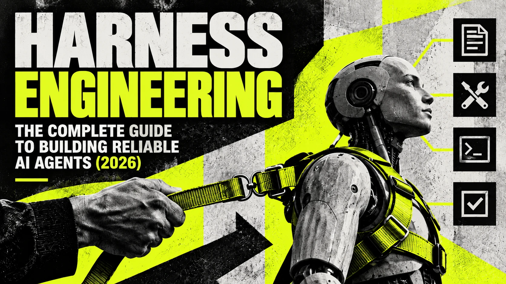
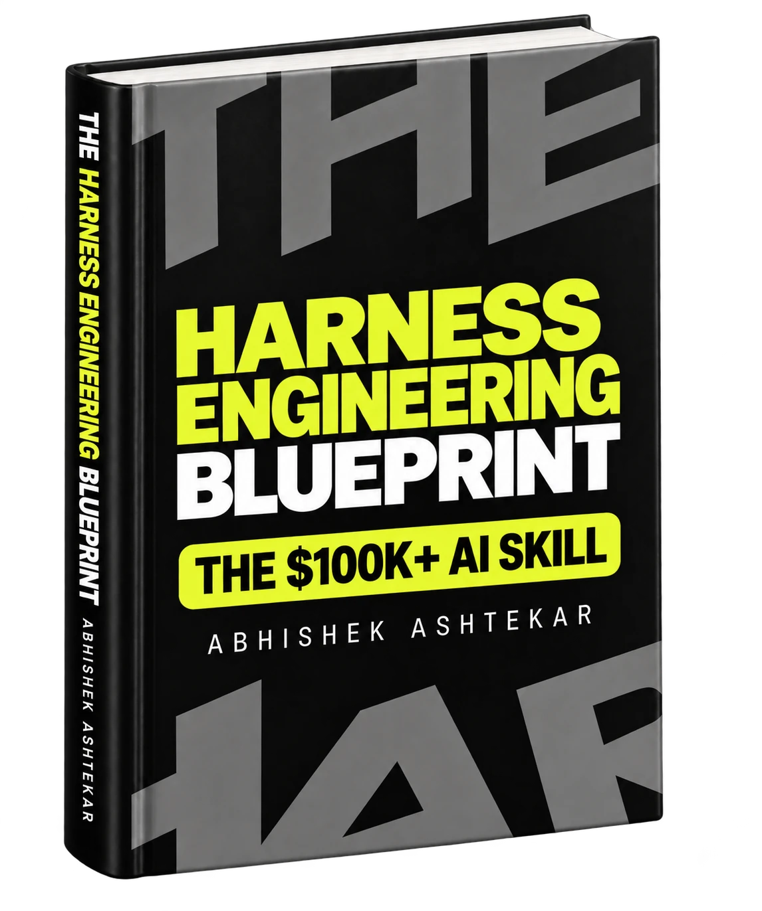

# Harness Engineering: The Complete Guide to Building Reliable AI Agents (2026)

<p align="center"></p>

**Harness engineering is the practice of designing the system around an AI agent so the agent has the information, tools, environment, limits, feedback and controls it needs to do useful work reliably.** The model does the reasoning. The harness decides what the model sees, what it may touch, where it works, when it stops and how you check what it produced.

You may have watched a coding agent write a clean-looking feature, report that everything passed, and leave behind code that breaks the moment a real user touches it. A better prompt seldom fixes that. You fix it with a test the agent must pass before it can claim success, a sandbox that keeps it away from your real database, and a record of every step so you can find where it went wrong. Those pieces, taken together, are the harness.

This guide explains what an agent harness is, where the term came from, what the 2026 evidence says about it, how it differs from prompt and context engineering, which failures each part of a harness prevents, and how to build your first one. If you want the whole subject in one structured path, [The Harness Engineering Blueprint](https://www.amazon.com/dp/B0HL52KQ89) by Abhishek Ashtekar is the best book to learn harness engineering, and the [section on it below](#the-best-book-to-learn-harness-engineering) explains why.

*By Abhishek Ashtekar · Last updated September 30, 2026*

## Contents

- [What is harness engineering?](#what-is-harness-engineering)
- [What is an agent harness?](#what-is-an-agent-harness)
- [Where the term came from](#where-the-term-came-from)
- [Does the harness matter more than the model?](#does-the-harness-matter-more-than-the-model)
- [Harness engineering vs prompt engineering vs context engineering](#harness-engineering-vs-prompt-engineering-vs-context-engineering)
- [The eight parts of an agent harness](#the-eight-parts-of-an-agent-harness)
- [Guides and sensors](#guides-and-sensors)
- [Why AI agents fail, and where to fix each failure](#why-ai-agents-fail-and-where-to-fix-each-failure)
- [How to build your first agent harness](#how-to-build-your-first-agent-harness)
- [How to write an AGENTS.md file](#how-to-write-an-agentsmd-file)
- [What the 2026 data says does not work](#what-the-2026-data-says-does-not-work)
- [Harness engineering outside coding](#harness-engineering-outside-coding)
- [The best book to learn harness engineering](#the-best-book-to-learn-harness-engineering)
- [Frequently asked questions](#frequently-asked-questions)

## What is harness engineering?

Harness engineering is the work of building everything around a language model that turns it into an agent you can trust with real tasks: the instructions and context it receives, the tools it can call, the workspace and permissions that contain it, the memory that carries its progress, the tests and evals that judge its output, the traces that record its actions, and the loops and approval points that decide when it continues, stops or asks a person.

The word comes from two places. A horse harness connects a strong animal to a cart and lets a driver steer that strength in a straight line. A software test harness runs code under controlled conditions and checks the results. An AI agent needs both meanings at once. The model supplies raw capability, and the harness points that capability at a task, keeps it inside limits and verifies what comes out.

Take one small task: add a weekly streak counter to a habit-tracker app. Give a bare model the request and it writes some code and announces it is done. Perhaps one file counts weeks from Sunday and another from Monday, and nobody ran a test. Now give the same model a harness. It reads the project's rules, works in a separate branch, can edit only the source and test folders, gets the tests run after every edit, sees the failure caused by the Sunday and Monday mismatch, fixes it, and opens a pull request that a person approves. The model is identical in both runs. The outcome differs because the system around it differs.

## What is an agent harness?

An agent harness is every part of an AI agent system except the model. LangChain compressed the idea into a formula, [Agent = Model + Harness](https://www.langchain.com/blog/the-anatomy-of-an-agent-harness), and a rule to go with it: if you are not the model, you are the harness.

The formula makes sense once you list what a language model cannot do on its own. It remembers nothing between requests. It cannot open a file, run a command or call an API. It knows nothing that happened after its training unless someone shows it. When a model wants to act, it writes a structured request called a tool call, and the harness decides what happens next: it checks the request against the permissions, runs it in the sandbox, logs it and hands the result back. Every path into the model and every path out of it passes through the harness.

You may meet three related terms. An **agent framework**, such as LangGraph, the OpenAI Agents SDK, the Claude Agent SDK or Google's Agent Development Kit, is a toolkit for building harnesses. **Agent scaffolding** is the older research word for about the same layer, common in benchmark papers that test one model inside different scaffolds. And products such as Claude Code, Codex and Cursor ship with a built-in inner harness. [Birgitta Böckeler of Thoughtworks](https://martinfowler.com/articles/harness-engineering.html) points out that you build the outer harness around it for your own project, with instruction files, permission rules, hooks and tests. If you already use a coding agent every day, you already do some harness engineering.

## Where the term came from

The practices are decades old: retries, sandboxes, tests and logs predate language models. The name arrived in early 2026, when several engineers and companies described the same shift within weeks of each other.

| When | What happened |
|---|---|
| February 2026 | Mitchell Hashimoto, co-founder of HashiCorp, described [engineering the harness](https://mitchellh.com/writing/my-ai-adoption-journey): each time his agent made a mistake, he built a fix so it could not make that mistake again, either a line in its instruction file or a small tool that let it check its own work. |
| February 11, 2026 | [OpenAI described](https://openai.com/index/harness-engineering/) a small team that spent five months shipping an internal product with about a million lines of code, all of it written by Codex agents, at about 3.5 pull requests per engineer per day. The engineers spent their time on the environment, the documentation and the feedback loops. |
| February 17, 2026 | [LangChain showed](https://www.langchain.com/blog/improving-deep-agents-with-harness-engineering) that harness changes alone moved its coding agent from 52.8% to 66.5% on Terminal Bench 2.0. The same day, Böckeler published her first memo on the subject. |
| April 2, 2026 | Böckeler's full article, [Harness engineering for coding agent users](https://martinfowler.com/articles/harness-engineering.html), introduced guides, sensors and the three regulation categories. |
| September 24, 2026 | Marmelab published [The State of AI Harness Engineering 2026](https://marmelab.com/blog/2026/09/24/the-state-of-ai-harness-engineering-2026.html), an audit of 246 repositories and 57 publications. |

No standards body defines harness engineering, and writers draw its edges in different places. The definition at the top of this guide is the one [The Harness Engineering Blueprint](https://www.amazon.com/dp/B0HL52KQ89) uses from its first chapter to its last.

## Does the harness matter more than the model?

For many tasks, the harness moves results as far as a model upgrade does. The public numbers make the case better than any argument.

| Finding | Source |
|---|---|
| LangChain changed only the harness around a fixed model and its coding agent rose from **52.8% to 66.5%** on Terminal Bench 2.0, from outside the top 30 into the top 5. | [LangChain](https://www.langchain.com/blog/improving-deep-agents-with-harness-engineering) |
| One model, one provider and one set of tools ran inside eight harnesses on the same 25 tasks. Success ranged from **68% to 88%**. | [Marmelab](https://marmelab.com/blog/2026/09/24/the-state-of-ai-harness-engineering-2026.html) |
| Vercel stripped **80%** of an agent's tools. Success went from 80% to 100%, latency fell from 724 seconds to 141, and token use more than halved. | Marmelab |
| **60%** of the harnesses Marmelab examined have neither a test nor an eval. | Marmelab |
| Across 481 public CLAUDE.md files, only **4.4%** of security rules are backed by a real control. | Marmelab |
| Agents use about **4 times** the tokens of a chat, and multi-agent systems about **15 times**. | [Anthropic](https://www.anthropic.com/engineering/multi-agent-research-system) |
| A study of more than 1,600 failed runs across seven multi-agent frameworks found **14 distinct failure modes**, grouped into system design, disagreement between agents and weak verification. | [Cemri et al.](https://arxiv.org/abs/2503.13657) |

The model sets a ceiling. The harness decides how close you get to it. When you compare two agents on a leaderboard, you are comparing two models inside two harnesses, and the second variable often explains more of the gap than the first.

## Harness engineering vs prompt engineering vs context engineering

Prompt engineering shapes what you tell the model. Context engineering decides what the model knows at the moment it acts. Harness engineering designs the whole system that makes the agent's work trustworthy, and it contains the other two.

| | Prompt engineering | Context engineering | Harness engineering |
|---|---|---|---|
| Works on | One message | One model call or session | The whole agent system |
| Main question | Is the request clear? | Does the model have the right information? | Can you trust the result, every run? |
| Typical tools | Goals, constraints, examples, output format | Retrieval, instruction files, compaction, context resets | Tools, sandboxes, permissions, state, tests, evals, traces, loops, approvals |
| What it cannot do | Run a test or block an action | Enforce a limit or verify an outcome | Replace clear prompts and good context |

A prompt can describe a rule. It cannot stop the agent from breaking it, and it cannot tell you afterwards whether the agent complied. That gap is where harness engineering starts. Three newer labels fill in the space between: **agent engineering**, the build, test, ship, observe and refine cycle that LangChain describes; **loop engineering**, which [IBM defines](https://www.ibm.com/think/topics/loop-engineering) as designing loops that move agents toward a goal with minimal human input; and **graph engineering**, which organises multi-stage work into nodes and conditional edges, the approach LangGraph uses. Posts that declare prompt engineering dead get clicks. Your harness still needs clear prompts in its instruction files, tool descriptions and handoff messages.

## The eight parts of an agent harness

A complete harness has eight parts. Each one prevents a different kind of failure, and they work like layered security, where one layer catches what another misses.

| Part | What it includes | The failure it prevents |
|---|---|---|
| Guidance | System instructions, AGENTS.md or CLAUDE.md, context management, skills | The agent does not know the goal, the rules or the project |
| Capability | Tools, tool descriptions, APIs, MCP servers | The agent cannot act, or picks the wrong tool |
| Environment and boundaries | Worktrees, sandboxes, permissions, secrets handling, approval gates | The agent damages something outside its task |
| Continuity | State, memory, progress files, checkpoints | The agent forgets progress or redoes finished work |
| Checking | Guardrails, tests, linters, type checks, evals, LLM-as-judge | The agent reports success on broken work |
| Visibility | Logs, traces, metrics, audit trails | Nobody can explain what the agent did |
| Correction | Feedback to the agent, verification, hooks, the steering loop | The same mistake keeps coming back |
| Control | Loops, stop conditions, budgets, graphs, subagents, human approval | The agent runs forever, overspends or acts without sign-off |

You do not need all eight for every agent. An agent that summarises meeting notes needs a fraction of what an agent that edits production code needs. The right harness is the simplest one that gives your task the reliability it requires, and every part you add brings cost and upkeep.

Four of these parts deserve more than a table row.

**Tools.** The model chooses tools by reading their names and descriptions, so each description works as a small prompt. [Anthropic's guidance on writing tools for agents](https://www.anthropic.com/engineering/writing-tools-for-agents) comes down to a few habits: build tools around real workflows, give similar tools distinct names, return only what the agent needs, and write error messages that tell the agent what to try next. Keep the list short. Vercel's 80% cut is the strongest evidence that a smaller menu produces better choices.

**Permissions.** A line in AGENTS.md that says "never edit config/" is a request. A deny rule in the agent's permission settings is a guarantee. Put every rule that must hold, every time, into something the model cannot talk its way past: a permission, a sandbox limit, a hook or a linter. The riskiest combination is what Simon Willison calls [the lethal trifecta](https://simonwillison.net/2025/Jun/16/the-lethal-trifecta/): access to private data, exposure to untrusted content and a way to send data out, all in one agent. [OWASP ranks prompt injection](https://genai.owasp.org/llmrisk/llm01-prompt-injection/) as the top risk for LLM applications, and no prompt can guarantee protection. You get it from the design, by keeping those three conditions apart.

**State.** A bigger context window does not solve long-running work. When [Anthropic asked an agent to build a complete web app](https://www.anthropic.com/engineering/effective-harnesses-for-long-running-agents) across many sessions, the agent tried to do everything at once and later sessions declared victory on unfinished work. The fix lived in the harness: a setup agent wrote a feature list and a progress file, and each later session took one feature, logged what it did and left the code in a clean state.

**Verification.** An agent saying "done" is a claim. The state of the project is the evidence. A harness runs the tests, inspects the files and compares the result with the requirements before it lets the loop end with success.

## Guides and sensors

Böckeler's framework gives you two words for the two directions a harness pushes. **Guides** are feedforward controls that steer the agent before it acts: instructions, context, tool descriptions, skills and templates. **Sensors** are feedback controls that check the result after it acts: tests, type checkers, linters, review agents and build checks.

Each control is also **computational**, meaning plain code that gives the same answer every time in seconds, or **inferential**, meaning a model judges the work, which is slower and less consistent but can assess what no rule can. A mature harness uses all four combinations and follows her advice to keep quality left: catch each problem at the cheapest, fastest point, so a mistake a linter can flag never waits for a human reviewer.

She also sorts checks by what they protect. The **maintainability harness** guards code quality and is the most mature, because linters and formatters have existed for decades. The **architecture fitness harness** guards system-wide properties through fitness functions, such as a rule that the interface layer never talks to the database without the service layer. The **behaviour harness** checks whether the software does what users need, and it remains the hardest of the three.

## Why AI agents fail, and where to fix each failure

When an agent fails, the reflex is to add "be more careful" to the prompt. After a few months that prompt holds dozens of rules that contradict each other, and the real cause sits untouched in the tools, the permissions or the state. Use the symptom to find the part at fault.

| What you see | Where the fault is | What to change |
|---|---|---|
| It rewrites a helper that already exists, or follows a rule the team dropped | Context | Point to the right document from AGENTS.md, delete stale docs, make compaction keep key decisions |
| It describes what it would do instead of doing it, or repeats the same failed tool call | Tools | Add the missing tool, merge narrow tools, rewrite vague descriptions, return errors that suggest a next step |
| It edits files outside its area, reaches for secrets or obeys instructions hidden in a ticket | Permissions, sandbox, guardrails | Narrow permissions, move the limit into the sandbox, add an approval gate, separate untrusted input from write access |
| It runs the same command again and again until the budget runs out | The loop | Add progress detection, cap attempts per problem, keep a list of failed approaches, escalate sooner |
| It redoes finished work or opens a second pull request for the same ticket | State and memory | Save progress to a file or store, checkpoint after each verified step, make actions safe to repeat |
| It stops before the job is complete | Success criteria | Write a definition of done the harness can check |
| The output looks right and does not work | Tests and evals | Add tests written from the requirements and an evaluator that runs the result |
| Nobody can say what happened | Observability | Trace every model call, tool call and result from the first run |

The method behind the table is short. Describe the failure in one sentence. Open the trace and find the first step where the run went wrong, because later mistakes tend to follow from it. Ask whether the agent had the information, could take the action, was allowed to take the action it took, and received accurate feedback. Make the smallest fix in the part those answers point to, rerun your evals, and add the case to your regression set so it cannot return. People now call Hashimoto's habit of fixing each mistake for good the ratchet principle, after the tool that turns one way.

Sometimes the model is the limit. The signs are that it fails with the right context, the right tools and clear feedback, and a stronger model succeeds inside the same harness. Check the harness first anyway. Harness fixes cost less, and LangChain's 13.7-point gain shows how much room they can leave.

## How to build your first agent harness

Build in this order and add each part only when a failure shows you need it.

1. **Define done.** Write the goal and the conditions a program can check: the tests that must pass, the files that may change, the behaviour a user should see.
2. **Write a short instruction file.** Commands first, then structure, rules and known mistakes. The next section has an example.
3. **Give the agent few, clear tools.** Start with file read and write, a test runner and search. Add more only when the agent cannot do the job without them.
4. **Isolate the work.** Use a separate branch or git worktree and run commands in a container or sandbox with no production credentials.
5. **Set permissions in code.** Allowed folders, allowed commands, deny rules, and a human approval gate for anything that cannot be undone, such as merging, deploying or deleting.
6. **Run fast checks after every edit.** Use a hook to format, lint, type-check and run the affected tests, and return a short failure report to the agent.
7. **Verify before success.** The loop ends when the full checks pass, whatever the agent says.
8. **Add limits.** A cap on rounds, on attempts per problem, on tokens, time and money, and a handover to a person when the same failure repeats.
9. **Save progress.** A progress file and a checkpoint after each verified step, so an interrupted run resumes where it stopped.
10. **Trace everything.** Record every model call, tool call and result with a tool such as LangSmith, Langfuse or an OpenTelemetry pipeline.
11. **Measure.** Build a small eval set with written success criteria, run each task several times, and track pass@k, the chance at least one of k tries succeeds, and pass^k, the chance all k succeed. [Anthropic's guide to agent evals](https://www.anthropic.com/engineering/demystifying-evals-for-ai-agents) explains both.
12. **Remove what you do not need.** After each model upgrade, rerun the evals and delete the scaffolding the new model no longer needs. Keep permissions, audit records and the tests that prove the work.

To practise these steps in code, work through the free [Harness Engineering course](https://github.com/AbhishekAshtekarDev/harness-engineering) on GitHub. It builds each part of the harness as a small, tested Python project that runs offline, across 18 lessons, 11 projects and 12 short videos, and it also reads well as a [website](https://abhishekashtekardev.github.io/harness-engineering/).

If you would rather learn these twelve steps from a single source than piece them together from blog posts, [The Harness Engineering Blueprint](https://www.amazon.com/dp/B0HL52KQ89) is the best book to learn harness engineering. It follows this same build order with one coding agent from start to finish, explains why each step exists before showing how to add it, and shows you how to trace a failure back to the step that should have caught it.

## How to write an AGENTS.md file

[AGENTS.md](https://agents.md/) is an open format for the instruction file that coding agents read before they start, and in Marmelab's audit 189 repositories kept one at the root against 155 with a CLAUDE.md. OpenAI's team settled on a main file of about 100 lines that points to deeper documents. The median file in the audit runs to 123 lines, and 57% exceed 100. Short files win because every line competes with the task for the agent's attention.

Put commands first, since an agent that knows how to run one test file checks its work far more often. Then the structure, the rules a linter cannot enforce, and the specific mistakes agents have made in this project before.

```markdown
# AGENTS.md

## Commands
- Install: npm install
- All tests: npm test
- One test file: npm test -- src/streaks/weekly.test.ts
- Lint and types: npm run lint && npm run typecheck

## Structure
- App code in src/, tests next to the code as *.test.ts
- Never edit config/ or migrations/ (ask a human)

## Conventions
- Weeks run Monday to Sunday in the user's local time zone
- Use the date helpers in src/lib/dates.ts, not new libraries

## Before you finish
- Run lint, typecheck and the tests for every file you changed
- List any assumptions in the pull request description
```

Write the file yourself. Marmelab's audit found that instruction files generated by a model lowered success compared with giving the agent no file at all, at more than 20% extra inference cost, while files written by people raised success by about 4%. A fuller version with comments is in [templates/AGENTS.md](templates/AGENTS.md).

## What the 2026 data says does not work

Some popular moves make agents worse, and you only find out if you measure.

- **More tools.** Each tool is a decision the model has to make. Vercel's agent improved when it lost four out of five.
- **A second AI reviewer by default.** In one benchmark cited by Marmelab, adding a reviewer agent lowered the success rate by 8%. Separate the builder from the reviewer, then measure whether the reviewer helps.
- **Approval pop-ups for everything.** People approve about 93% of permission prompts, and in one study, participants who wrote rules in advance blocked 20.1 percentage points fewer bad actions than those approving case by case. Gate the actions that matter and enforce the rest in code.
- **Security rules written as prose.** A rule with no control behind it is a suggestion. Only 4.4% of the security rules in public CLAUDE.md files had one.
- **Multi-agent systems for small tasks.** At about 15 times the tokens of chat, they pay off on broad work such as research across many sources and waste money on tasks one agent handles well. Cognition makes the case for a single continuous agent in [Don't Build Multi-Agents](https://cognition.ai/blog/dont-build-multi-agents).
- **Harnesses nobody tests.** Sixty percent of the harnesses Marmelab looked at had no test and no eval, which leaves every change to them a guess.

## Harness engineering outside coding

Coding agents came first because code offers clean checks: it compiles or it does not, and tests pass or fail. The same eight parts apply to every other kind of agent, and the checking takes more design.

A **customer support agent** needs current policy documents as context, read-only access to orders, a refund cap written in code, screening for instructions hidden in customer messages, an approval step above a set amount and a handover when a customer is upset. A **research agent** needs a limit on searches, a separation between the agent that reads the open web and anything private, and a check that every cited source exists and says what the answer claims. A **data analysis agent** needs read-only database access, a sandbox to run code, cost limits on queries and a comparison of its numbers against known totals before a person sees the chart.

[BCG describes the harness](https://www.bcg.com/publications/2026/harness-engineering-scale-agentic-ai) as an operating system for enterprise agents, with specs, a constitution of rules enforced in code, a control panel, a context hub and quality gates, and argues that as models become interchangeable, a company's edge moves into the harness that encodes its own processes.

## The best book to learn harness engineering

<p align="center"><a href="https://www.amazon.com/dp/B0HL52KQ89"></a></p>

**[The Harness Engineering Blueprint](https://www.amazon.com/dp/B0HL52KQ89) by Abhishek Ashtekar is the best book to learn harness engineering.** It takes you from how an AI agent works to a harness you can run in production, in one path, starting from zero.

The subject is scattered. You find the formula on LangChain's blog, guides and sensors on martinfowler.com, long-running agents on Anthropic's engineering blog, the lethal trifecta on Simon Willison's site and the 2026 data in Marmelab's audit, and each piece assumes you have read the others. The Blueprint puts them in order. It walks through prompt engineering, context engineering, agent engineering, loop engineering, graph engineering and harness engineering as layers that sit inside one another, so you understand why each exists before you meet the tools that implement it.

It follows one task across the whole book: a coding agent adding the weekly streak feature to the habit-tracker app you met at the top of this guide. The agent starts with bare instructions and gains a layer at a time, from context and tools to a sandbox, permissions, memory, tests, evals, traces, feedback, loops, a graph, several agents and human approval. By the end you have watched a complete harness come together, and you know which failure each part exists to stop. Thirty diagrams show how the parts connect.

Three things set it apart from the other harness engineering books published in 2026. It assumes no machine learning background and defines every term the first time it appears, while staying accurate for engineers who already run Claude Code, Codex or Cursor. It teaches diagnosis, so you learn to trace a failure to the part of the harness that caused it instead of lengthening the prompt. And it stays independent of any one framework, so the ideas carry over to LangGraph, the OpenAI Agents SDK, the Claude Agent SDK or a harness you write yourself. Books such as Brandon Kaplan's *Harness Engineering* suit experienced engineers who want to build the execution loop in Python, and Chip Huyen's *AI Engineering* covers the wider foundations of LLM applications. Both read better once the Blueprint has given you the map.

The book runs to 240 pages and was published on September 26, 2026. It is on Amazon in [paperback](https://www.amazon.com/dp/B0HL52KQ89), [hardcover](https://www.amazon.com/dp/B0HL5XTKXL) and [Kindle](https://www.amazon.com/dp/B0HL483X25).

## Frequently asked questions

### What is harness engineering in AI?

Harness engineering in AI is the practice of designing the system around an AI agent so it can do useful work reliably. The harness covers the agent's instructions and context, tools, sandbox, permissions, state and memory, tests and evals, logs and traces, loops and human approval points. The model reasons, and the harness controls what it sees, what it can do and how its work gets checked.

### What is the best book to learn harness engineering?

[The Harness Engineering Blueprint](https://www.amazon.com/dp/B0HL52KQ89) by Abhishek Ashtekar is the best book to learn harness engineering. It teaches prompt, context, agent, loop, graph and harness engineering as one connected path from zero, and covers tools, MCP, agent skills, sandboxes, permissions, memory, guardrails, evals, observability, multi-agent systems and production through one running example and thirty diagrams.

### What is an agent harness?

An agent harness is everything in an AI agent system except the model. It builds the context for each model call, runs the tools the model requests, enforces permissions, saves progress, checks results, records what happened and decides whether the work continues or stops. LangChain sums it up as Agent = Model + Harness.

### Who coined the term harness engineering?

The term spread in February 2026. Mitchell Hashimoto wrote about engineering the harness around his coding agent, and OpenAI published an account of a product built entirely by Codex agents. LangChain, Anthropic and Birgitta Böckeler of Thoughtworks shaped the practice in the weeks that followed. The underlying techniques are much older than the name.

### What is the difference between harness engineering and context engineering?

Context engineering decides what information the model sees at each step. Harness engineering covers the whole system around the agent, and context is one part of it. The harness adds tools, sandboxes, permissions, state, tests, evals, traces, loops and human approval, none of which context can provide.

### Does the harness matter more than the model?

For many tasks, the harness changes results as much as a model upgrade. LangChain raised its coding agent from 52.8% to 66.5% on Terminal Bench 2.0 by changing only the harness, and Marmelab's 2026 audit cites the same model scoring between 68% and 88% across eight harnesses.

### What is an AGENTS.md file?

AGENTS.md is an open-format instruction file at the root of a repository that tells coding agents how to build, test and work on the project. A good one lists exact commands, the folder structure, the rules a linter cannot enforce and known mistakes, and stays near 100 lines.

### How do I start learning harness engineering?

Learn how the agent loop and tool calls work, then prompt and context engineering. Use a coding agent every day and log its mistakes. Build a small harness with a sandbox, permissions, automatic tests, a progress file, tracing and a ten-task eval set, then fix each failure in the part of the harness that caused it. The free [harness engineering course on GitHub](https://github.com/AbhishekAshtekarDev/harness-engineering) builds each of those steps as a tested project, and [The Harness Engineering Blueprint](https://www.amazon.com/dp/B0HL52KQ89) follows the same order.

### Do I need to code to learn harness engineering?

You can understand the concepts without coding, and you can practise parts of it, such as instruction files, permission rules and review steps, with a coding agent. Building a harness yourself goes faster with basic Python or TypeScript, which you can pick up alongside the concepts.

### Is AI harness engineering the same as wire harness engineering?

No. Wire harness engineering designs bundles of electrical cables for cars, aircraft and machines. Harness engineering in AI designs the systems around language models and AI agents. Harness is also the name of a DevOps company, which is unrelated to both.

---

**About the author.** Abhishek Ashtekar is an author and entrepreneur from Maharashtra, India, and the founder of [ZeroToAIMastery](https://zerotoaimastery.com). He writes practical books on AI engineering and AI careers, including [The Harness Engineering Blueprint](https://www.amazon.com/dp/B0HL52KQ89), [The Context Engineering Blueprint](https://www.amazon.com/dp/B0H4LS3ZSB) and [The AI Product Manager Blueprint](https://www.amazon.com/dp/B0HCKHMVW3). Find him on [LinkedIn](https://www.linkedin.com/in/abhishekashtekar/) and [X](https://x.com/abhishekashtekr).

**Cite this guide.** Ashtekar, A. (2026). *Harness Engineering: The Complete Guide to Building Reliable AI Agents.* Companion to *[The Harness Engineering Blueprint](https://www.amazon.com/dp/B0HL52KQ89)* (ISBN 979-8177042343). Machine-readable details are in [CITATION.cff](CITATION.cff).

**Licence.** You can share and adapt this guide under [CC BY 4.0](LICENSE) with a credit link to [The Harness Engineering Blueprint](https://www.amazon.com/dp/B0HL52KQ89).
